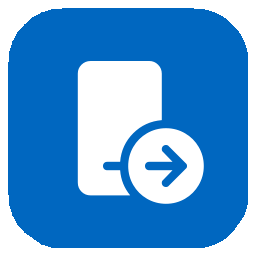
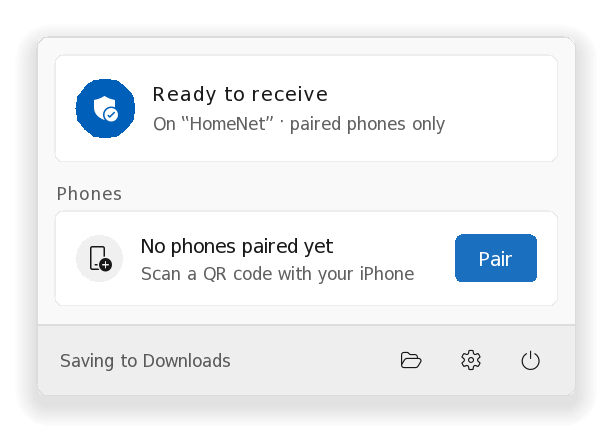
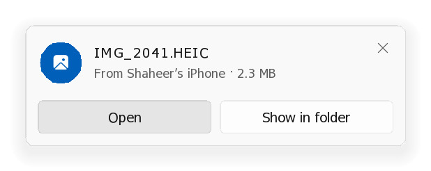
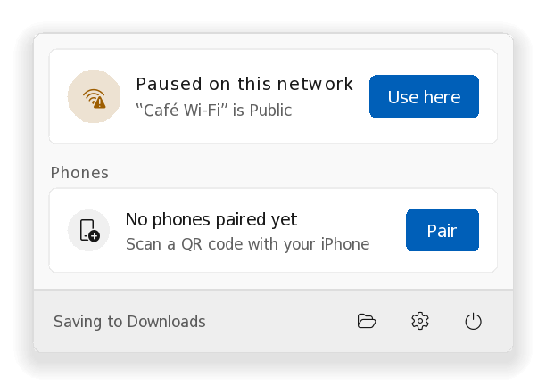
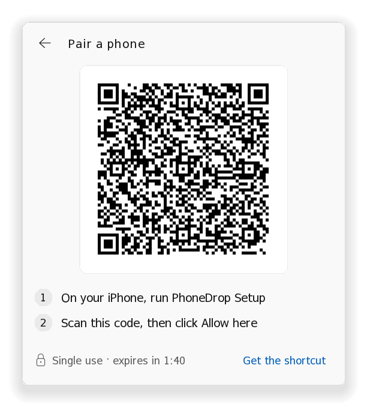
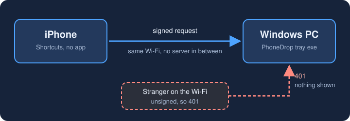

<p align="center"></p>
<h1 align="center">PhoneDrop</h1>
<p align="center"><b>AirDrop-style sharing between your iPhone and your Windows PC.</b><br>No iPhone app, one tiny tray exe, nothing running when idle.</p>
<p align="center"><sub>An independent project, not affiliated with or endorsed by Apple or Microsoft. AirDrop and iPhone are trademarks of Apple Inc.</sub></p>

<p align="center">

[](https://github.com/mynameishaheer/phonedrop/actions/workflows/build.yml)
[](LICENSE)
[](https://github.com/mynameishaheer/phonedrop/releases/latest)
[](go.mod)

</p>

<!--
  DEMO GIF (record before launch, then uncomment the line below and delete this comment).
  Save as docs/media/demo.gif, ideally under 3 MB and about 800 px wide. In about 10 seconds with
  no cuts: share a photo from the iPhone share sheet -> "Send to PC", then the toast on the PC with
  Open / Show in folder. If it fits, add the other direction: right-click a file on the PC -> Send
  to -> PhoneDrop, then "Receive from PC" on the phone. Phone and PC captures side by side work well.

  <p align="center"></p>
-->

<p align="center">
<picture><source media="(prefers-color-scheme: dark)" srcset="docs/media/panel-ready-dark.png"></picture>
<picture><source media="(prefers-color-scheme: dark)" srcset="docs/media/toast-file-dark.png"></picture>
</p>

## What it does

<!-- TODO: screenshot of the share sheet with "Send to PC" (docs/media/iphone-share.png) -->
- **Share sheet:** send photos, videos, files, text and links to the PC. Files land in Downloads (or a folder you pick).
- **One tap:** Back Tap, Action Button, Control Center or Siri sends your latest screenshot or clipboard.
- **Text and links:** text goes to the PC's clipboard. Links show an **Open link** toast and are never opened for you.
- **PC → phone:** right-click a file → **Send to → PhoneDrop (to phone)**, or press **Ctrl+Alt+P** to send the clipboard. On the phone, run **Receive from PC**.

## Install

### 1. On the PC (Windows 10 or 11)

1. Download **PhoneDrop-Setup.exe** from the [latest release](../../releases/latest) and double-click it. No admin needed.
2. If SmartScreen warns (the exe isn't code-signed yet): **More info → Run anyway**.
3. Keep **Let my iPhone reach PhoneDrop through Windows Firewall** ticked and click **Yes** when Windows asks. The rule covers only **Private** and **Domain** networks.
4. Click the tray icon (it may be under **^**). It should say **Ready to receive**.

<details><summary>It says <b>Paused on this network</b></summary>

Windows calls this Wi-Fi *Public*, so PhoneDrop isn't listening. Click **Use here**.

<picture><source media="(prefers-color-scheme: dark)" srcset="docs/media/paused-public-dark.png"></picture>

</details>

The installer adds a Start-menu entry and a right-click **Send to → PhoneDrop (to phone)** entry, and starts PhoneDrop at sign-in.
Uninstall from **Settings → Apps**. Settings and paired phones stay in `%LOCALAPPDATA%\PhoneDrop`.

Prefer no installer? Each release also has the plain `phonedrop.exe` and `install.ps1`; see [docs/DEV.md](docs/DEV.md#portable--scripted-install).

### 2. On the iPhone

1. Get the shortcuts. One-tap iCloud links are coming with v1.0. Until then, build them with
   [docs/SHORTCUTS.md](docs/SHORTCUTS.md) (about 20 minutes, once) or sign the generated ones on a Mac ([shortcuts/README.md](shortcuts/README.md)).
2. On the PC, click **Pair**. On the iPhone, run **PhoneDrop Setup** and scan the code.
3. On the PC, click **Allow**.

<picture><source media="(prefers-color-scheme: dark)" srcset="docs/media/pair-dark.png"></picture>

## What it isn't

Not real AirDrop. That runs over Apple's private Wi-Fi link (AWDL), which Windows drivers can't speak. PhoneDrop uses your normal network.
Both devices need the same Wi-Fi and the PC must be awake. There are no push notifications to the phone, so you collect PC → phone items by running a shortcut.

## Why PhoneDrop?

Other tools do more, on more platforms. PhoneDrop's niche is narrow: **iPhone ↔ Windows, nothing to install on the phone, nothing running on the PC when idle.**

| | PhoneDrop | Microsoft Phone Link | LocalSend | Intel Unison | PairDrop / Snapdrop |
|---|---|---|---|---|---|
| App on the iPhone | **None** (Shortcuts) | Yes | Yes | Yes | None (web page) |
| On the PC | One tray exe | Built into Windows | App | App | A browser tab |
| Files iPhone → PC | Yes | Rolling out; often unreliable | Yes | Yes (discontinued) | Yes |
| Open source | Yes (MIT) | No | Yes | No | Yes |
| Platforms | iPhone + Windows only | Android, limited iPhone | Most | Was iPhone/Android + Windows | Anything with a browser |

Intel Unison was discontinued in 2025. Phone Link's iPhone file sharing is often reported failing. LocalSend and PairDrop are excellent and far more general. Details change; check each project.

## Security



| | |
|---|---|
| **Pairing** | QR code with a fresh 256-bit secret, valid once for 2 minutes, never sent over the network. You confirm with **Allow** on the PC. |
| **Every request** | Signed with the phone's secret, with a timestamp (±90 s) and a single-use nonce. |
| **Strangers** | Same bare `401`, nothing on screen. An IP that keeps failing is shut out for 5 minutes. |
| **Networks** | Listens only on *Private* (or Domain) networks. On a café or hotel network, nothing is listening. |
| **At rest** | Phone secrets are encrypted with Windows DPAPI. |
| **Received files** | Sanitized names, never overwritten, Mark-of-the-Web. Programs and scripts are never opened from a toast. |

Transfers are not encrypted by default, so someone on your Wi-Fi who can see the traffic could read them. They still can't send to your PC.
Full threat model and the **Encrypt transfers (beta)** option: [docs/SECURITY-MODEL.md](docs/SECURITY-MODEL.md).

## Troubleshooting

| Symptom | Fix |
|---|---|
| Panel says **Paused on this network** | Windows calls the Wi-Fi *Public*. Click **Use here** (or make the network Private in Windows settings). |
| Phone says it can't connect | Same Wi-Fi on both? Some guest and office networks block device-to-device traffic. Re-run the installer: it offers the firewall rule. |
| *A server with the specified hostname could not be found* | `.local` names don't resolve here. In Files → iCloud Drive → Shortcuts → PhoneDrop, edit `config.json`: replace the host in `base` with one of the `ips` (keep `:47474`). |
| Every request fails with *unauthorized* | The PC logs the reason in `%LOCALAPPDATA%\PhoneDrop\phonedrop.log`. Usual causes: a clock more than 90 s off, or stray spaces around `\|` in a hand-built shortcut. |
| SmartScreen blocks the exe | **More info → Run anyway**, after [verifying the download](#verifying-a-download). |

## FAQ

**Does it work away from home?** On any network where both devices can reach each other and Windows calls it *Private*. Not across the internet yet; a relay is on the [roadmap](docs/ROADMAP.md).

**Is it safe on public Wi-Fi?** By default PhoneDrop doesn't listen there. If you click **Use here**, only your paired phone can send, but others on that network could read your transfers. Prefer your own network.

**Android or Mac?** Not today. The shortcuts are iOS-only and the server is a Windows app. The protocol is plain HTTP ([docs/PROTOCOL.md](docs/PROTOCOL.md)), so other clients are possible.

**Was this written by AI?** Largely, yes, with a person deciding, testing on real devices and reviewing. See [docs/HOW-IT-WAS-BUILT.md](docs/HOW-IT-WAS-BUILT.md).

More answers (Shortcuts vs an app, resource use, unsigned warning): [docs/FAQ.md](docs/FAQ.md).

## Verifying a download

PhoneDrop is only published at **github.com/mynameishaheer/phonedrop** (and the winget and Scoop packages that point there).
Each release has a `SHA256SUMS.txt`, and both exes carry a GitHub build-provenance attestation tying it to the commit and CI run that built it:

```powershell
Get-FileHash .\PhoneDrop-Setup.exe -Algorithm SHA256       # compare with SHA256SUMS.txt
gh attestation verify .\PhoneDrop-Setup.exe --repo mynameishaheer/phonedrop
```

## Build

```sh
scripts/build.sh    # runs the tests, then cross-compiles phonedrop.exe (Go 1.24+, standard library only)
```

The code is in `cmd/phonedrop/`. Code map: [docs/DEV.md](docs/DEV.md). Wire protocol: [docs/PROTOCOL.md](docs/PROTOCOL.md).

## Contributing

Bug reports, ideas and pull requests are welcome: start with [CONTRIBUTING.md](.github/CONTRIBUTING.md) or a [good first issue](https://github.com/mynameishaheer/phonedrop/labels/good%20first%20issue).
Questions go in [Discussions](https://github.com/mynameishaheer/phonedrop/discussions). Security problems: [SECURITY.md](.github/SECURITY.md), not a public issue.

## Roadmap

Details in [docs/ROADMAP.md](docs/ROADMAP.md); changes so far in [CHANGELOG.md](CHANGELOG.md).

- **v1.0:** first stable release.
- **iCloud shortcut links:** one-tap install of all six shortcuts.
- **Optional push notifications** via [ntfy](https://ntfy.sh), so the phone knows something is waiting.
- **Relay for off-LAN sending**, and **encryption out of beta** once verified on real iPhones.

## Licence

MIT. Icons: [Fluent UI System Icons](https://github.com/microsoft/fluentui-system-icons) (MIT).
