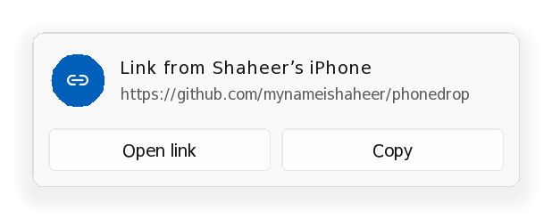
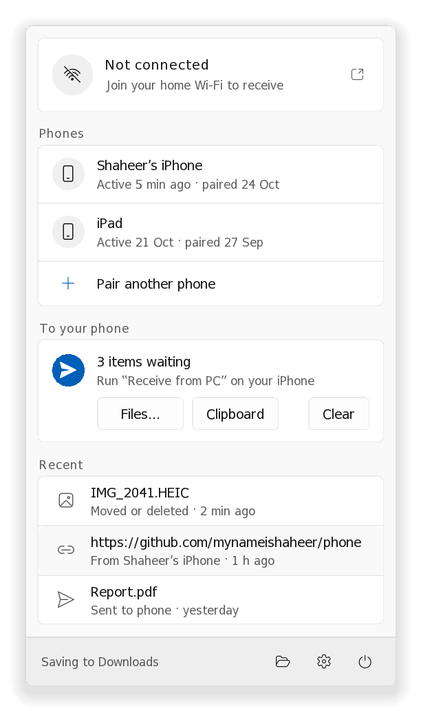

# Building the iPhone shortcuts by hand

**Easiest:** use the one-tap iCloud links (coming with v1.0) or the signed files ([shortcuts/README.md](../shortcuts/README.md)).
This page is the manual fallback. It takes about 20 minutes, once, in Apple's **Shortcuts** app.
Afterwards you can share each shortcut as an iCloud link, so other people install it with one tap.

| # | Shortcut | What it does |
|---|---|---|
| [1](#1-phonedrop-sign-helper) | **PhoneDrop Sign** | Helper that signs each request. You never run it yourself. |
| [2](#2-phonedrop-setup) | **PhoneDrop Setup** | Pairs the iPhone by scanning the PC's QR code. Run once. |
| [3](#3-send-to-pc-photos-videos-files) | **Send to PC** | Share sheet: photos, videos, files. With no input, lets you pick photos. |
| [4](#4-send-text-to-pc-text-links-clipboard) | **Send Text to PC** | Share sheet: text and links. With no input, sends the clipboard. |
| [5](#5-send-latest-screenshot) | **Send Latest Screenshot** | One tap (Back Tap, Action Button, Control Center) sends your newest screenshot. |
| [6](#6-receive-from-pc) | **Receive from PC** | Collects what the PC sent: photos to Photos, files to Files, text to the clipboard. |

**Before you start:** in **Settings → Apps → Shortcuts → Advanced**, turn on **Allow Sharing Large Amounts of Data**.

## Common pieces

Every shortcut below uses these. Learn them once.

**Reading the steps**

- `Action name` is what you type in the search bar at the bottom of the editor. **Bold** words are settings inside an action.
- `Action` → **Name** means: add a `Set Variable` action right after it, type the name, and set its input to that action's output.
- *Name* in italics means: tap the field, choose **Select Variable**, and pick the variable *Name*.
- *Config.secret* means: insert the variable *Config*, tap it, and choose the key `secret`.
- Type the `|` characters and keys exactly as shown, with no spaces.

**Sign** (used by every shortcut except Sign itself)

1. `Dictionary` with the keys `method`, `path` and `body` (and others where the step says so).
2. `Run Shortcut` **PhoneDrop Sign** with that *Dictionary* → **Req**.

**Send** (right after Sign)

`Get Contents of URL`: URL *Req.url*, the method the step names, and these five **Headers**, where *Req* is what *PhoneDrop Sign* returned (insert *Req*, tap it, pick the key). The step may add more headers and sets the **Request Body**. Then → **Result**.

| Header | Value |
|---|---|
| `X-PD-Phone` | *Req.phone* |
| `X-PD-Time` | *Req.time* |
| `X-PD-Nonce` | *Req.nonce* |
| `X-PD-Body` | *Req.body* |
| `X-PD-Sig` | *Req.sig* |

**Check** *X* (the answer in variable *X*)

The PC's answers always contain the word `true` when something worked, and never when it didn't. *Get Contents of URL* hands back its answer as a file, and `If` only offers **contains** for text, so first put the answer in a `Text` action.

1. `Text`: *X*.
2. `If` that *Text* **does not contain** `true`: `Show Alert` "PhoneDrop: *X*", then `Stop This Shortcut`. **End If**.

---

## 1. PhoneDrop Sign (helper)

Create a new shortcut named exactly **PhoneDrop Sign**. It reads the pairing file and returns the URL and headers for one request. The other shortcuts call it with a *Dictionary* holding `method`, `path` and `body`.

1. `Get File from Folder`: folder **Shortcuts**, path `PhoneDrop/config.json`, **Error If Not Found** on. → **ConfigFile**.
   Shortcuts may pre-fill the folder with *Shortcut Input*: tap it, **Clear**, then pick iCloud Drive → **Shortcuts**.
2. `Get Dictionary from Input` (input: *ConfigFile*) → **Config**.
3. `Format Date`: date **Current Date**, **Date Format** *ISO 8601*, **Include ISO 8601 Time** on → **Time**.
4. `Random Number` from `100000000` to `999999999` → **R1**.
5. `Random Number` from `100000000` to `999999999` → **R2**.
6. `Text`: *R1* *R2* *Time*. Then `Generate Hash` **SHA256** of that *Text* → **Nonce**.
7. `Text` (one line):
   *Config.secret*`|`*Shortcut Input.method*`|`*Shortcut Input.path*`|`*Time*`|`*Nonce*`|`*Shortcut Input.body*

   For *Shortcut Input.method*, insert **Shortcut Input**, tap it, choose **Dictionary**, key `method`. Do the same for `path` and `body`.

   > **No spaces around the `|`.** It must read `…secret|GET|/v1/pair|…`, not `secret | GET`.
   > The keyboard sometimes adds a space next to a variable bubble; delete it. A single extra
   > space makes every request `unauthorized` (the PC's log then says *signature mismatch*).
8. `Generate Hash` **SHA256** of the *Text* from step 7 → **Inner**.
9. `Text`: *Config.secret*`|`*Inner* (again no spaces).
10. `Generate Hash` **SHA256** of the *Text* from step 9 → **Sig**.
11. `Text`: type `http://`, then insert *Config* (key `base`) and, right after it with no space, **Shortcut Input** → **Dictionary** → key `path`.
    It reads `http://` [Config: base] [Shortcut Input: path] → **URL**.

    *Only with **Encrypt transfers** on the PC:* this Text must say `https://` for everything except Setup's two requests (which pass `plain`). See [§7](#7-encryption-optional-beta).
12. `Dictionary`, with these keys (type **Text**):

    | Key | Value |
    |---|---|
    | `url` | *URL* |
    | `phone` | *Config.id* |
    | `time` | *Time* |
    | `nonce` | *Nonce* |
    | `body` | *Shortcut Input.body* |
    | `sig` | *Sig* |

13. `Stop and Output`: the *Dictionary*.

In the shortcut's settings (ⓘ), make sure **Show in Share Sheet** is off.

## 2. PhoneDrop Setup

Create **PhoneDrop Setup**.

1. `Scan QR or Barcode` → **QR**.
2. `Get Dictionary from Input` (input: *QR*) → **Pairing**.
3. `If` *QR* **contains** `secret`. Inside the If:
   1. `Set Name` of *QR* to `config.json` (otherwise Shortcuts may save it as `config.txt`).
      Then `Save File`: input *Renamed Item*, **Ask Where to Save** off, **Destination Path** `PhoneDrop/config.json`, **Overwrite If File Exists** on.
   2. `Get Device Details`: **Device Name** → **Name**.
   3. `Generate Hash` **SHA256** of *Name* → **BodyHash**.
   4. **Sign** with `method` = `POST`, `path` = `/v1/pair`, `body` = *BodyHash*, `plain` = `1`. (**Show While Running** off.)
   5. **Send**: **POST**, the five headers from *Req*, **Request Body** **File** = *Name*.
   6. `Text`: *Result* (just the variable). Then `If` that *Text* **contains** `true`: `Show Alert` "Paired! You're ready to send."
      **Otherwise**: `Show Alert` "Pairing didn't work: *Result*", then `Stop This Shortcut`. **End If**.
   7. *Only with **Encrypt transfers** on the PC:* add the extra steps from [§7](#7-encryption-optional-beta) here. Otherwise skip.
4. **Otherwise**: `Show Alert` "That isn't a PhoneDrop code." **End If**.

To pair: on the PC, click the tray icon → **Pair**. On the iPhone, run **PhoneDrop Setup** and scan the code. Then on the PC click **Allow**.

<picture><source media="(prefers-color-scheme: dark)" srcset="media/pair-dark.png"></picture>

<!-- TODO: screenshot of the finished PhoneDrop Setup shortcut in the editor (docs/media/iphone-setup.png) -->

## 3. Send to PC (photos, videos, files)

Create **Send to PC**. In its settings (ⓘ) turn on **Show in Share Sheet**. In the first action, set **Receive** to *Images, Media, Files* and **If there's no input** to **Ask For → Photos** (or add `Select Photos` with **Select Multiple** on).

1. `Repeat with Each` item in **Shortcut Input**. Inside:
   1. `Get Name` of *Repeat Item*. Then `URL Encode` it → **EncodedName**.
   2. `Generate Hash` **SHA256** of *Repeat Item* → **BodyHash**.
   3. **Sign** with `method` = `POST`, `path` = `/v1/items`, `body` = *BodyHash*.
   4. **Send**: **POST**, the five headers from *Req* plus `X-PD-Name` = *EncodedName*, **Request Body** **File** = *Repeat Item*.
   5. **Check** *Result*.
2. **End Repeat**. Optionally `Show Notification` "Sent to PC".

> **Videos:** if a video fails with *"produced no file representation"*, add `Encode Media`
> (**Size** *Passthrough*) as the first action inside the Repeat, and use its output instead of
> *Repeat Item* in steps 2 and 4. Passthrough doesn't re-compress, so it's quick.

<!-- TODO: screenshot of the share sheet with "Send to PC" (docs/media/iphone-share.png) -->

On the PC, photos and files are saved (default: Downloads) and a notification offers **Open** and **Show in folder**.

<picture><source media="(prefers-color-scheme: dark)" srcset="media/toast-file-dark.png"></picture>

## 4. Send Text to PC (text, links, clipboard)

Create **Send Text to PC**. **Show in Share Sheet** on, **Receive** *Text, URLs, Rich Text, Safari web pages*, **If there's no input** → **Get Clipboard**.

1. `Text`: **Shortcut Input** → **Body**. This turns links and pages into plain text, so the hash and the upload are the same bytes.
2. `Generate Hash` **SHA256** of *Body* → **BodyHash**.
3. **Sign** with `method` = `POST`, `path` = `/v1/items`, `body` = *BodyHash*.
4. **Send**: **POST**, the five headers from *Req* (no `X-PD-Name`), **Request Body** **File** = *Body*.
5. **Check** *Result*.

The PC copies text to its clipboard (if *Copy received text* is on) and shows links with an **Open link** button.

<picture><source media="(prefers-color-scheme: dark)" srcset="media/toast-link-dark.png"></picture>

## 5. Send Latest Screenshot

1. Duplicate **Send to PC** and name it **Send Latest Screenshot**.
2. Turn **Show in Share Sheet** off.
3. Put `Get Latest Screenshots` (**1**) at the top.
4. Make the Repeat loop over *Latest Screenshots* instead of *Shortcut Input*.

### One gesture

| Trigger | Where to set it |
|---|---|
| **Back Tap** (double/triple tap the back of the phone) | Settings → Accessibility → Touch → Back Tap |
| **Action Button** (iPhone 15 Pro and later) | Settings → Action Button → Shortcut |
| **Control Center / Lock Screen** (iOS 18+) | Edit Control Center → Add a Control → Shortcuts |
| **Siri** | Say the shortcut's name |
| **Share sheet** | Share → **Send to PC** / **Send Text to PC** |

A good set: Back Tap double → **Send Latest Screenshot**, triple → **Send Text to PC** (sends the clipboard), and a Control Center button → **Receive from PC**.

## 6. Receive from PC

On the PC you queue things for the phone in three ways: right-click files in Explorer → **Send to → PhoneDrop (to phone)**; the panel's **Files…** and **Clipboard** buttons; or **Ctrl+Alt+P**, which sends the clipboard. The phone collects them with **Receive from PC**.

<picture><source media="(prefers-color-scheme: dark)" srcset="media/panel-full-dark.png"></picture>

1. **Sign** with `method` = `GET`, `path` = `/v1/outbox`, `body` = `-` (one hyphen).
2. **Send**: **GET**, the five headers from *Req*. (Name the output **List** instead of *Result*.)
3. **Check** *List*.
4. `Get Dictionary Value` key `items` in *List* → **Items**. `Count` *Items*; if it **is** `0`, `Show Notification` "Nothing waiting on the PC" and `Stop This Shortcut`.
5. `Repeat with Each` item in *Items*. Inside:
   1. `Get Dictionary Value` key `kind` in *Repeat Item* → **Kind**.
   2. `If` *Kind* **is** `text`: `Copy to Clipboard` *Repeat Item.text*. **End If**.
   3. `If` *Kind* **is** `url`: `If` *Repeat Item.text* **begins with** `http`: `Open URLs` *Repeat Item.text*. **Otherwise**: `Copy to Clipboard` it. **End If**. **End If**.
   4. `If` *Kind* **is** `image`, and again for `video` and `file` (three Ifs, or `Otherwise`s):
      1. **Sign** with `method` = `GET`, `path` = *Repeat Item.path*, `body` = `-`. Name the output **FileReq**.
      2. **Send**: **GET**, the five headers from *FileReq*, URL *FileReq.url*. (Name the output **Download**.)
      3. For `image` and `video`: `Save to Photo Album` *Download*. For `file`: `Save File` *Download* (**Ask Where to Save** on).
6. **End Repeat**. `Show Notification` "Received *Count* from the PC".

Text and links leave the PC once listed; files once downloaded. Anything not collected within 24 hours is dropped.

## 7. Encryption (optional, beta)

Only if you turn on <b>Encrypt transfers</b> on the PC. Open for the extra steps.

With **Settings → Encrypt transfers** on, the PC acts as a tiny certificate authority that may only vouch for itself (its own `.local` name and private IP addresses). The Setup shortcut downloads it, checks it against the hash in the QR code so nobody on the network can swap it, and saves it for you to install. From then on the phone talks to the PC over HTTPS only.

**Change PhoneDrop Sign** so it picks https:

1. Replace step 11's `http://` with a *Scheme* variable.
2. Before step 11 add `Text` `http` → **Scheme**.
3. `Get Dictionary Value` key `tls` in *Config*, and `If` it **has any value**: `Get Dictionary Value` key `plain` in **Shortcut Input**, `If` that **does not have any value**: `Text` `https` → **Scheme**. **End If**, **End If**.
4. In step 11 use *Scheme* followed by `://` instead of `http://`.

**Extra step in PhoneDrop Setup** (inside the If, after step 3.6):

`Get Dictionary Value` key `tls` in *Pairing*. `If` *Dictionary Value* **has any value**:

1. **Sign** with `method` = `GET`, `path` = `/v1/ca.mobileconfig`, `body` = `-`, `plain` = `1`. Name the output **ProfileReq**.
2. `Get Contents of URL`: URL *ProfileReq.url*, **GET**, the five headers from *ProfileReq* → **Profile**.
3. `Generate Hash` **SHA256** of *Profile*, then `Change Case` to **lowercase** → **ProfileHash**.
4. `If` *ProfileHash* **is** *Pairing.ca*:
   `Set Name` of *Profile* to `PhoneDrop.mobileconfig`, then `Save File` *Renamed Item*, **Ask Where to Save** off, **Destination Path** `PhoneDrop/PhoneDrop.mobileconfig`, **Overwrite If File Exists** on.
   `Show Alert`: "Last step: in the Files app open iCloud Drive → Shortcuts → PhoneDrop and tap PhoneDrop.mobileconfig. Then Settings → Profile Downloaded → Install, and Settings → General → About → Certificate Trust Settings → turn on PhoneDrop."
   **Otherwise**: `Show Alert`: "The certificate didn't match the QR code. Don't install anything; pair again on your home network."
   **End If**.

**End If**.

**Later changes**

- Turned encryption **on** after pairing? Remove the phone in the PC's panel and pair again, so the new QR code carries the certificate.
- Turned it **off**? Phones paired with it on keep trying HTTPS, so pair them again too.
- **Beta:** the PC relies on iOS enforcing the certificate's name constraints, which hasn't been checked on a real iPhone yet. See [SECURITY-MODEL.md](SECURITY-MODEL.md).

## 8. Troubleshooting

| You see | Meaning |
|---|---|
| `unauthorized` | The PC didn't accept the signature. Check §1 steps 6–10 character by character (the `\|` separators, no spaces). Right after pairing, rerun Setup. |
| *Could not connect to the server* | The PC isn't listening: does the tray panel say *Ready to receive*? Is the phone on the same Wi-Fi? |
| *A server with the specified hostname could not be found* | `.local` names don't resolve on this network. In Files, open Shortcuts → PhoneDrop → `config.json` and replace the host in `base` with one of the `ips` (keep `:47474`). |
| `denied` | Someone clicked Deny on the PC, or nobody answered within 50 seconds. Run Setup again. |
| `body hash mismatch` | What was sent isn't what was hashed. For text and links use **Send Text to PC**; for videos see the note in §3. |
| `use https` / *certificate is invalid* | Encryption settings changed since pairing ([§7](#7-encryption-optional-beta)). Pair again. |
| Your old pairing stopped working after a failed Setup | Setup saves the new code before the PC says yes. Run Setup again and click Allow. |

## 9. For developers

Test vector for the signature (see <a href="PROTOCOL.md#3-signed-requests">PROTOCOL.md §3</a>)

| Input | Value |
|---|---|
| secret | `9f86d081884c7d659a2feaa0c55ad015a3bf4f1b2b0b822cd15d6c15b0f00a08` |
| method, path | `POST`, `/v1/items` |
| time | `2026-10-24T22:15:24+05:00` |
| nonce | `n0nce-7f3a9c21` |
| body (`hello`) | `2cf24dba5fb0a30e26e83b2ac5b9e29e1b161e5c1fa7425e73043362938b9824` |
| **inner** | `f795c82b4e578020b2393c09a9ca484d8e006738bf732af151ef43a93dff74ad` |
| **sig** | `936b011316a67ab2656939ab738b1786fa40ca55380faeec5111d0693056caaf` |

If *Generate Hash* prints upper-case hex, the inner hash is upper case and the signature is
`f14fe1f8e6dab993f61ab6229ca63ceaeb81a26f86a206d2b77149e51fc0c449`, which the PC also accepts.

